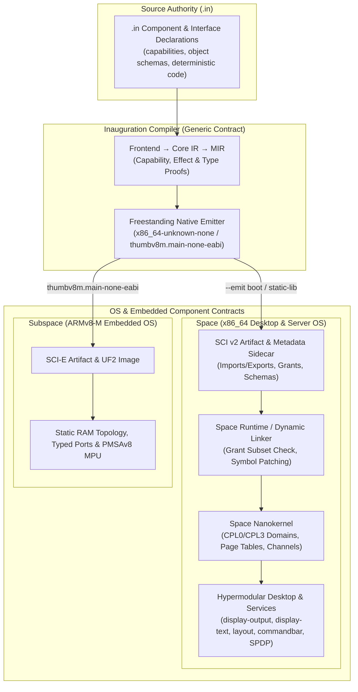
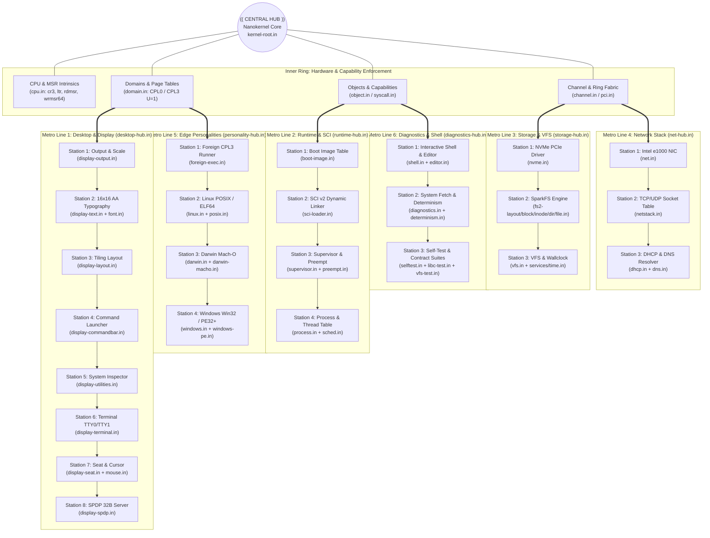
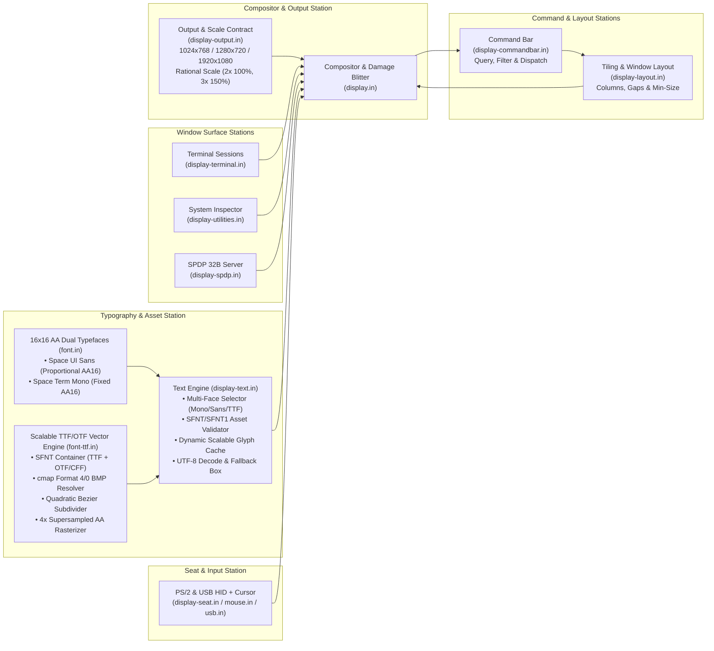

# Space

Space is a component-based operating system built on a five-layer architecture:

```
       .in          ← native language
       ↑
 Inauguration       ← compiler — the real OS contract
       ↑
      SCI           ← component image format (replaces ELF)
       ↑
    Space           ← operating system, component runtime
       ↑
 Nanokernel         ← hardware enforcement layer
```



The native model is **component + capability + object + execution graph** — not
process + file + syscall + user. Linux, Darwin, and Windows personalities are
kernel-linked `.in` translators in the same boot image (`components/linux.in`,
`darwin.in`, `windows.in`, `posix.in`). They are not isolated processes.

Kernel-linked service domains clone the 4 GiB identity map and run at CPL0;
that is not isolation. SCI user guests have a separate CPL3 path. See
[`architecture.md`](architecture.md) for the exact boundaries.

**Design priority:** hypermodular components and explicit capability/interface
contracts, with a minimal nanokernel and generic Inauguration → SCI tooling. The
current root links services as boot scaffolding. The [original desktop design](docs/plans/2026-10-19-command-desktop.md)
uses simple tiling and a command bar with separate layout, input, compositor and
application responsibilities. [AGENTS.md](AGENTS.md) records the contributor invariants.
Resolution, scaling and multiple typefaces are specified and tracked in the
[display and text architecture](docs/plans/2026-10-19-display-text-architecture.md).
See the [cross-repository architecture](docs/plans/2026-10-19-three-repository-architecture.md) for Subspace and Inauguration.

### Radial Mind-Map & Metro-Map Architecture

Space's kernel and services are organized around a **Central Nanokernel Hub (`kernel/kernel-root.in`)** radiating outward into six modular **Metro Lines** (`*-hub.in`), where each station owns a single focused responsibility:



### Hypermodular Desktop & Display Pipeline



## Status

The nanokernel root, written in `.in` and compiled by
[Inauguration](https://github.com/tschk/inauguration), enters x86_64 long mode
under QEMU. Desktop works via shell `desktop` (kernel-linked `components/display.in`,
`display-output.in`, `display-text.in`, `display-layout.in`, `display-commandbar.in`,
`font.in`, and PS/2 `components/mouse.in`). `fb mode <w> <h>` and `fb scale <2|3>`
switch validated BGA resolutions (`1024×768`, `1280×720`, `1920×1080`) and rational
scales (`100%` / `150%`), while rendering two concurrent typefaces (`Space UI Sans`
proportional UI chrome and `Space Term Mono` fixed-cell terminal text) with UTF-8
decoding and deterministic missing-glyph fallback boxes. Tab opens a bounded command bar for existing
windows, tiling, close/minimize and terminal focus; command and layout modules
remain kernel-linked groundwork. Maintained checks: shell + full runtime
display/input (preempt-stop), SCI loader (`hello`/`uecho`), execve SCI from FS,
Linux demo / ELF personality, VFS, NVMe volume multi-file + deep soak, UDP/TCP
data path, DHCP lease, DNS A for dotted names, personalities (Linux/Windows/Darwin).
Components are dynamically linked: SCI v2 images carry export/import tables and
the loader binds user components against the `libspace` shared library at load
time. The nanokernel is itself a link provider (its boot image carries an
export table; 670+ symbols registered at boot), loaded modules register their
own exports for later modules, and a dynamic module importing an unknown
symbol is denied while boot continues (`scripts/check-dynamic-modules.sh`).

**Space 0.1.0** ships two images (`scripts/build-images.sh`): a full
**standard** image (network, NVMe/USB, personalities, display) and a **minimal**
image (core dynamic nanokernel + filesystem shell, ~3x smaller). Both carry
preinstalled dynamic apps — `calc` (expression REPL), `notes` (persistent
notes), `hd` (file hexdump), `sysmon` (live kernel monitor), `bench`
(deterministic CPU benchmark) — that load on demand into per-app domains via
the shell's `runapp` command (`scripts/check-image-variants.sh`).

Subsystem status is tracked in [`architecture.md`](architecture.md).
Linux/Windows/Darwin personality progress: [`docs/personalities-roadmap.md`](docs/personalities-roadmap.md).

## Benchmarks

Measured on macOS ARM64 (M3 TCG), Inauguration v0.9.3 via `scripts/bench-boot.sh`
(5 iterations, median / min / max).

| Metric | Median | Min | Max |
|--------|--------|-----|-----|
| Boot image size | 542,332 B | — | — |
| Kernel compile (warm) | 132 ms | 103 ms | 187 ms |
| Boot to interactive shell | 676 ms | 611 ms | 769 ms |
| Boot to halt | 1,095 ms | 955 ms | 1,326 ms |

Measured via serial output polling on Apple M3 (macOS, QEMU TCG).

### Performance notes

- Boot-to-shell is ~700 ms class on M3 TCG; dominated by firmware + serial path.
- The warm compile path is cached by source hash; repeated edits rebuild fast.
- `scripts/boot.sh` drops into an interactive shell. Type `halt` to exit.
- `scripts/bench-boot.sh` runs 5 iterations and reports median/min/max.
- Shell `desktop` starts the kernel-linked display + PS/2 mouse path.

## Target architectures

| Arch | Compiler status | Kernel status |
|------|-----------------|---------------|
| x86_64 | Native lowering, boot image, ELF object | Boots verified subsystems |
| ARM64 | Native lowering, boot image, ELF object | Platform boot work remains |
| RISC-V | Planned | — |

## Build and run

Requirements: `clang`, `nasm`, `qemu-system-x86_64`, and Inauguration —
installed from crates.io (`cargo install inauguration --locked`), a sibling
checkout at `../inauguration`, or via `$INAUGURATION_DIR`. There is no vendor
submodule.

```sh
cargo install inauguration --locked
```

```sh
bash scripts/check-all.sh             # static gates + QEMU boot + audit hardening
bash scripts/check-qemu-boot.sh       # full boot verification
bash scripts/build-multicomponent.sh  # SCI component loading demo
bash scripts/check-sci-contract.sh    # metadata validation
bash scripts/check-architecture-boundaries.sh  # component authority gate
bash scripts/check-kernel-contracts.sh         # syscall/domain/net host contracts
bash scripts/check-image-formats.sh            # SCI packer + SparkFS/SCI headers
bash scripts/check-runtime-honesty.sh          # TCP/PCI/SparkFS/ELF honesty contracts
bash scripts/check-process-vfs.sh              # process table / VFS / DHCP / libc
bash scripts/check-personality-abi.sh          # Linux/Darwin/Windows syscall ABI
bash scripts/check-qemu-smoke.sh               # boot to serial shell + hardening
bash scripts/check-qemu-shell.sh               # help / ps / mem over serial
bash scripts/check-network.sh         # e1000 ARP/UDP test
bash scripts/check-terminal-editor.sh # serial editor save test
bash scripts/check-desktop-visual.sh  # desktop / display visual path
bash scripts/check-desktop-damage.sh  # moving-window compositor bench
python3 scripts/check-commandbar.py --in "$HOME/.cargo/bin/in" --out /tmp/space-commandbar  # command bar & layout model/JIT/native gate
python3 scripts/check-desktop-launcher.py --in "$HOME/.cargo/bin/in"                        # QEMU PS/2 command bar, tiling & pointer gate
python3 scripts/check-display-output-text.py --in "$HOME/.cargo/bin/in"                     # QEMU BGA modes (1080p/720p/768p), scales & dual-typeface gate
bash scripts/check-spdp-composite.sh  # SPDP surface-pipeline proof
bash scripts/check-spdp-protocol.sh    # SPDP wire-format / parser contract
bash scripts/check-audit-fixes.sh     # kernel-audit hardening assertions
bash scripts/check-linux-elf.sh       # Linux ELF personality
bash scripts/check-volume-deep-soak.sh # NVMe volume deep soak
bash scripts/check-fs-dirs.sh         # mkdir/rmdir/mv/rm full coverage
bash scripts/check-personalities.sh   # Linux/Windows/Darwin personalities
bash scripts/check-darwin-macho.sh    # trusted in-place Mach-O fixture
```

Browser demo (Alpenglow-style v86 shell, built with moonshine): see [`docs/v86-website.md`](docs/v86-website.md) and `website/`.

## Repository layout

```
kernel/
  kernel-root.in            central nanokernel hub component
  guest-service.in          SCI guest component example
  v86-kernel.in             browser/v86 kernel variant
components/
  cpu.in                    x86_64 CPU control & MSR wrappers (cr3, ltr, rdmsr, wrmsr64)
  desktop-hub.in            Desktop & Display Metro Line hub
  runtime-hub.in            Runtime & SCI Metro Line hub
  storage-hub.in            Storage & VFS Metro Line hub
  net-hub.in                Network Stack Metro Line hub
  personality-hub.in        Edge Personalities Metro Line hub
  display.in                kernel-linked compositor & damage engine (shell `desktop`)
  display-output.in         output modes, rational scale & coordinate transforms
  display-text.in           dual-typeface roles, SFNT1 validator, UTF-8 & fallback box
  display-layout.in         titlebar-aware horizontal tiling policy
  display-commandbar.in     command bar query, filtering & action dispatch
  display-utilities.in      System Inspector panel (sidebar, display, typeface & seat cards)
  display-terminal.in       TTY0/TTY1 terminal session buffers & status header strip
  display-seat.in           cursor bitmap & pointer/keyboard seat routing
  display-spdp.in           SPDP 32-byte protocol server & shared memory pools
  font.in                   16x16 AA Space Term Mono & Space UI Sans glyph atlases
  font-ttf.in               freestanding TTF/OTF SFNT parser, Bezier subdivider & AA rasterizer
  font-asset-spacesans.in   embedded SpaceSans TrueType font asset table
  display-standalone.in     standalone display SCI component
  libspace.in               shared-library SCI (dynamic-linking provider)
  mouse.in                  PS/2 mouse input
  shell.in                  interactive serial shell
  pci.in                    PCI bus enumeration
  volume-mem.in             memory-backed Volume SCI component
  linux.in / windows.in / darwin.in   OS personality surfaces
boot/
  multiboot.asm             x86_64 CPU bring-up (32-bit → long mode)
scripts/
  check-parallel.py         35-suite multi-threaded parallel verification runner
  check-ttf-font.py         TrueType & OpenType font platform verification gate
  pack-ttf-asset.py         SFNT inspector, verifier & asset generator
  check-qemu-boot.sh        full boot verification
  check-desktop-visual.sh   desktop / display visual path
  check-desktop-launcher.py QEMU PS/2 command bar, tiling & pointer checks
  check-display-output-text.py  output modes, scales, dual typefaces & UTF-8 checks
  check-linux-elf.sh        Linux ELF personality
  check-volume-deep-soak.sh NVMe volume deep soak
  check-fs-dirs.sh          mkdir/rmdir/mv/rm full coverage
  check-personalities.sh    Linux/Windows/Darwin personalities
  bench-boot.sh             boot timing (median/min/max)
```

## Relationship to Inauguration

Per [`AGENTS.md`](AGENTS.md), Space owns the OS contracts, examples, SCI profile,
and boot plan. Inauguration owns the generic compiler capabilities:

- freestanding target support (`x86_64-unknown-none`)
- SCI-compatible component metadata emission
- native x86_64 lowering, instruction encoding, boot image assembly
- Core IR optimization
- multi-frontend support (.in, Rust, Go, V, Tree-sitter polyglot)

Inauguration does not depend on this repository. Space does not add
Space-branded targets to Inauguration.

## License

[Mozilla Public License 2.0](LICENSE)
