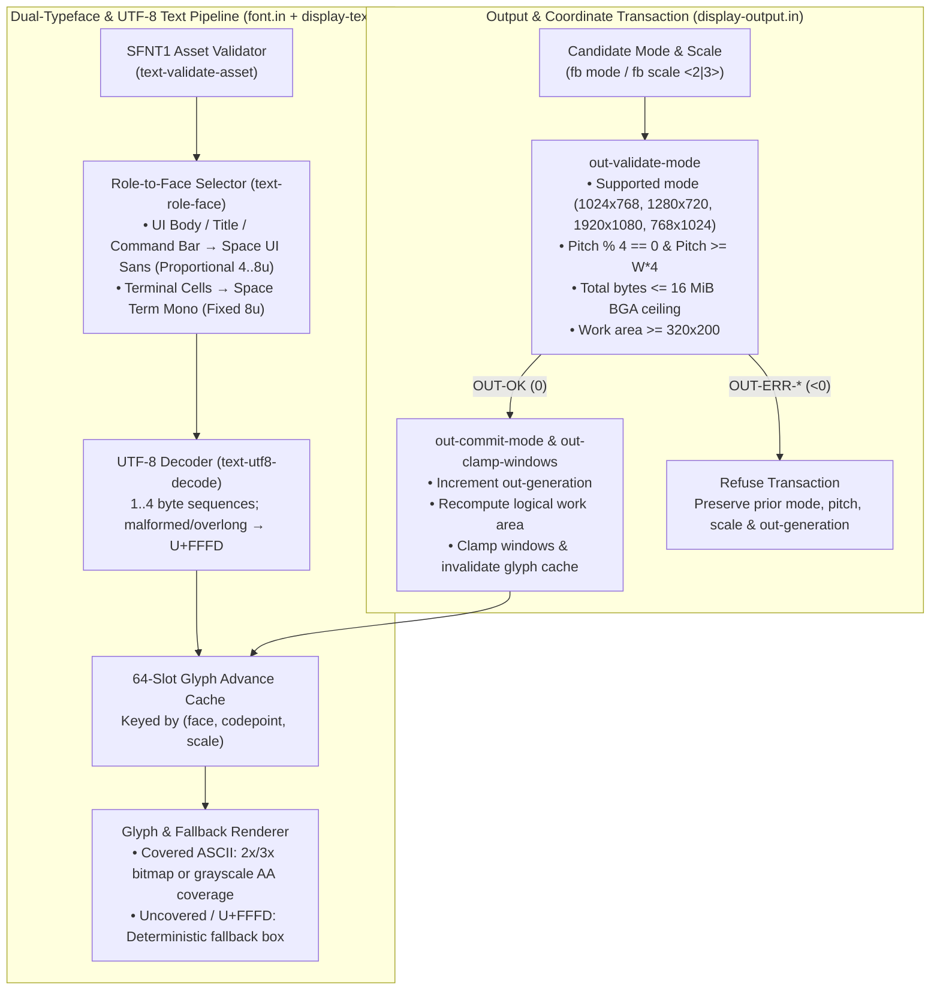

# Space display and text platform

## Purpose and priority

User direction, 2026-10-19: think beyond a framebuffer demo. Resolution,
scaling and multiple typefaces are the immediate foundations. Build a proper,
original desktop faithful to Space's component/capability/object/execution-graph
model. A simple niri-like tiling experience and Raycast/Rover-like command bar
are the shell, not the whole platform. This document specifies the destination
and a migration plan; it does not claim these capabilities exist today.

## Observed baseline

`components/display.in` requests 1920×1080×32 through BGA, reads back dimensions
and virtual width, and has a Multiboot framebuffer fallback. Pitch is available
but substantial chrome and tests assume one resolution. The utilities view even
prints a literal resolution. `components/font.in` supplies a bounded 8×8 ASCII
bitmap face; the anti-aliased path derives coverage for that face. Enlarging a
bitmap or smoothing its pixels is not another typeface, shaping or a font engine.
SPDP uses fixed 32-byte frames and packed 16-bit geometry. Existing SCI proofs
are bounded and do not establish a fully isolated interactive desktop. These are
migration inputs, not permanent product constraints.

## End-state service graph

The names below describe responsibilities, not new implemented SCI interfaces.
Do not freeze their wire encoding until native ownership and versioning are
specified against the existing contracts.

| Service | Owns | Receives | Must not own |
|---|---|---|---|
| Output/device backend | mode discovery, physical scanout, pitch/format, presentation | validated output configuration and frame work | shell policy, app launching, font parsing |
| Compositor | surface tree, transforms, clipping, damage, buffer synchronization | committed surfaces and layout transactions | foreign process models, command query state |
| Seat/input | device normalization, keymaps, focused delivery, routing authority | device events and authorized focus changes | application text buffers or unrestricted global input for clients |
| Layout | stable window identities, columns, viewport, floating geometry | window lifecycle, logical work areas, bounded actions | pixel memory or privileged device addresses |
| Shell/bar | query, result providers, selection, action confirmation, status | registry/object views permitted by its grants | arbitrary privileged code execution |
| Text/font service or library | face catalog, immutable font assets, shaping/measurement/raster cache | text/style requests and permitted assets | input capture, app lifecycle, display ownership |
| Application/session supervisor | SCI launch, dependencies, grants and failure lifecycle | explicit launch requests | window geometry policy |
| Clients and compatibility adapters | client content and translated protocol state | granted surfaces, input, text APIs | ambient kernel/other-client authority |

A service graph does not require every tiny helper to become an IPC service.
Keep pure geometry and text operations composable; choose shared library versus
service based on ownership, failure containment and measured cost. The nanokernel
provides enforcement and execution/IPC mechanisms. It does not become a desktop,
a font engine or a foreign graphics kernel. Build with `.in` and general compiler
capabilities; do not move product policy into Inauguration.

## Output and coordinate contract

An output description needs stable identity, current/supported pixel modes,
physical pixel dimensions, pitch, pixel format, transform, logical extent,
scale and a configuration generation. Optional physical-size/refresh metadata
must be marked unknown when unavailable. Distinguish output identity from its
current mode. A surface is not permanently tied to one output or scale.

Use logical coordinates for shell/layout/hit testing and explicit transforms at
the compositor/backend boundary. Define scale as a rational value and specify
rounding centrally: outward bounds for damage, consistent shared edges for tiles,
and the inverse transform for pointer hit testing. Fractional scale cannot mean
independently truncating each client rectangle. Cursor, glyph baseline and input
must agree on the same transform. Include rotations and negative multi-output
origins in the design, even when the first backend supports one unrotated output.

Validate mode/configuration as a transaction before changing the live output:
overflow-safe buffer size, format/pitch, memory limits, supported mode and logical
work area. Prepare replacement resources, switch at an observable presentation
boundary, and retain/recover the last valid configuration on failure. A stale
commit from an earlier output generation cannot reuse freed scanout buffers.
Resize clamps floating windows and recomputes tiled layout without losing window
identity, focus or content. Output removal relocates reachable windows and keeps
the bar usable; it must not silently destroy application sessions.

SPDP packed geometry is a current wire constraint. Larger coordinates, signed
origins and scale/output events require an explicit versioned extension or
validated coordinate translation. Do not silently reinterpret existing fields or
introduce a second native bus. Add emitter/packager/client/server tests when an
artifact/interface contract changes.

## Multiple typefaces and text correctness

Separate face identity, font asset, family/style/weight, size, logical metrics,
glyph coverage and output raster scale. Product text roles should select faces
through a theme contract: interface/body, command/query, terminal/monospace,
symbols and fallback. At least two genuinely distinct permissively distributable
faces must render simultaneously in the first typeface acceptance slice, with
license and provenance recorded. A scale multiplier or copied bitmap is not a
second face. Terminal cell metrics must remain stable when the UI face changes.

A text request includes encoding, direction/language where relevant, role/style,
size and width constraints. The architecture must account for UTF-8 validation,
Unicode fallback, combining marks, grapheme boundaries, bidirectional text and
script shaping. Font lookup, shaping, measurement and rasterization are separate
steps. Layout measures the same shaped run that rendering paints. Selection,
caret movement, deletion and hit testing operate on text boundaries rather than
bytes or guessed fixed-width cells. Initial ASCII-only milestones must say so;
do not present them as the final text contract.

Font assets are untrusted input. Validate supported formats and bounds; use
bounded caches keyed by asset/face/glyph/size/scale/render mode with explicit
lifetime/invalidation. Fallback must be deterministic and visibly handle a missing
glyph. Support grayscale coverage first; do not assume subpixel order on unknown
panels. Decide color-font/emoji support explicitly instead of accepting a format
that is silently misrendered. Maintain accessibility through legible contrast,
configurable text size, visible focus and keyboard-complete actions.

The dependency decision must evaluate mature shaping/rasterization libraries
before hand-writing a font parser or Unicode shaper. Verify upstream licenses,
portable runtime needs, memory/allocator/error ABI, target build and actual
Space execution. Existing local GPUI/Crepuscularity code may inform reusable
abstractions, but host rendering is not proof of a freestanding Space backend.
No particular dependency is selected or imported by this plan.

## Buffer, resource and authority contract

Keep clients' content buffers owned by their domains. The compositor receives a
bounded, provenance-checked shared mapping, not a client-writable physical pointer.
Define attach/commit/damage/presentation/release and disconnect behavior before
adding asynchronous rendering. A producer must not mutate an in-flight buffer;
a consumer must not read beyond a validated stride/extent. Specify who releases
mapping, backing pages, surface IDs, caches and output resources on each failure.
The existing synchronous SCI pixel proof is not buffer synchronization evidence.

Shell actions reference authorized objects and stable generations. Close/reindex
must not redirect an outstanding command to a different window. A result label
is not launch authority. Font access, input routing, output control and application
launch use distinct responsibilities and least necessary grants. Preserve the
compiler → SCI → packaging → loader boundary and existing denial tests.

## Reuse decision before compositor expansion

Compare three concrete implementation paths against these contracts: retain the
software framebuffer backend while extracting services; port a mature compositor
core/backend through native adapters; or run an upstream stack through a proven
compatibility runtime. Evaluate portability, required syscalls/libraries,
render/text support, protocol coverage, license, maintenance and isolation cost.
A dependency name is not a port plan. Require a minimal client/presentation proof
on Space for the chosen path, preserve fallback boot, and document why alternatives
were rejected. Reuse proven rendering/text code where it fits; do not turn a large
from-scratch compositor into an unexamined prerequisite for the original shell.

### Evaluated implementation paths (2026-10-19)

| Path | Candidate stack | Portability & runtime requirements | Protocol / text coverage | License & isolation cost | Decision |
|---|---|---|---|---|---|
| **Path A: Modular `.in` service extraction over software BGA/Multiboot scanout + bounded font/shaping adapter** | Native `.in` modules (`display-output.in`, `display-text.in`, `display-layout.in`, `display-commandbar.in`, `font.in`) + SPDP 32-byte shared-page channel | Zero libc/POSIX dependency; compiles directly with Inauguration `--target-triple x86_64-unknown-none`; deterministic fixed-arena memory | Validated BGA mode transactions (`1024x768`, `1280x720`, `1920x1080`), rational scale (`2x`/`3x`), dual concurrent typefaces (`Space Term Mono` + proportional `Space UI Sans`), UTF-8 decoding, missing-glyph fallback box, SPDP damage/input | CC0-1.0 / MIT; preserves nanokernel/SCI capability boundaries and 30+ fps bounded damage | **Selected for Slices 1–3** (with explicit `SFNT1` asset validator ready for offline/adapter glyph table ingestion) |
| **Path B: Port upstream C/Rust compositor & font stack (`wlroots`/`smithay` + `freetype`/`harfbuzz`/`stb_truetype`) via freestanding C/FFI** | Upstream C libraries linked into freestanding image or SCI service | Requires `malloc`/`free`, `libm` floating-point math, C ABI shims, and ~150 KB+ code/tables for TrueType/OpenType hinting & GPOS/GSUB | Full OpenType/TrueType outlines and complex script shaping | MIT / FTL / BSD; linking a C allocator into CPL0 violates nanokernel minimal-TCB rules until isolated in a CPL3 SCI font/compositor service | **Deferred to CPL3 SCI Font/Text Service (Slice 4)**; binary `SFNT1` header/bounds contract implemented now in `text-validate-asset` |
| **Path C: Upstream Wayland compositor & clients via Linux/Darwin personality runtime** | Stock Wayland compositor + `epoll`/`drm`/`gbm`/`memfd` translation | Requires full POSIX process lifecycle, `mmap` shared fds, Unix domain sockets, DRM/KMS ioctls | Full stock Wayland ecosystem | High TCB and impedance mismatch; violates Space's native component + capability + object model (`AGENTS.md`) | **Rejected** as native desktop foundation (Wayland remains an edge compatibility adapter target for Slice 5) |

### Executable port spike and implemented contracts

1. **`components/display-output.in` (Output, Coordinate & Mode Transaction Contract):**
   - Owns output identity (`out-id`), monotonic configuration generation (`out-generation`), physical mode (`out-phys-w`, `out-phys-h`, `out-pitch`, `out-bpp`), rational scale (`out-scale-num`, `out-scale-den`), rotation (`out-rotation`), logical dimensions (`out-logical-w`, `out-logical-h`), and work-area geometry (`out-work-x`, `out-work-y`, `out-work-w`, `out-work-h`).
   - Validates candidate mode changes as an overflow-safe transaction (`out-validate-mode`) against supported modes (`1024×768`, `1280×720`, `1920×1080`, plus portrait logical geometry fixture `768×1024`), 4-byte pitch alignment, minimum logical work-area (`>= 320×200`), and the 16 MiB BGA framebuffer ceiling (`FB-BUFFER-MAX-BYTES = 16777216`). Refuses invalid/overflow modes (`OUT-ERR-DIMENSIONS`, `OUT-ERR-UNSUPPORTED`, `OUT-ERR-PITCH`, `OUT-ERR-OVERFLOW`, `OUT-ERR-SCALE`, `OUT-ERR-WORK-AREA`) while preserving the prior active output state and generation.
   - Centralizes coordinate transforms (`out-logical-to-phys-x/y`, `out-phys-to-logical-x/y`), outward damage rounding (`out-damage-phys-x0/x1`), shared tile column edges (`out-tile-col-x/w` so adjacent columns never overlap or gap), and window clamping across resolution switches (`out-clamp-windows`).
   - Switches live QEMU BGA scanout modes at runtime (`out-set-bga-mode`) via `fb mode <w> <h>` and `fb scale <2|3>`.

2. **`components/font.in` and `components/display-text.in` (Dual-Typeface, UTF-8, Cache & Fallback Contract):**
   - **Two genuinely distinct, permissively distributable faces rendered concurrently:**
     - **Face 0 (`FONT-FACE-MONO = 0`, `Space Term Mono`):** Public Domain / CC0-1.0 8×8 fixed-width terminal programmer strike (`fb-font` / `fb-font-aa`), constant 8-unit logical advance, seriffed `I`/`1`/`l` and zero-slash for unambiguous terminal cells.
     - **Face 1 (`FONT-FACE-SANS = 1`, `Space UI Sans`):** MIT / CC0-1.0 original geometric proportional sans-serif strike (`fb-font-sans` / `fb-font-sans-aa` / `fb-font-sans-adv`), variable per-glyph logical advances (`4..8` units: narrow `I`/`i`/`l`/`.`/`:`/`!` at 4 units, compact `1`/`f`/`j`/`r`/`t` at 5–6 units, standard caps/digits at 7 units, wide `M`/`W`/`m`/`w` at 8 units) and distinct sans-serif glyph geometry.
   - **Role selection & terminal cell invariants:** `text-role-face` maps `TEXT-ROLE-UI-BODY`, `TEXT-ROLE-UI-TITLE`, `TEXT-ROLE-CMD-QUERY`, and `TEXT-ROLE-STATUS` to `FONT-FACE-SANS`, while pinning `TEXT-ROLE-TERM-MONO` to `FONT-FACE-MONO`. Terminal cell metrics (`text-term-cell-w`, `text-term-cell-h`, `text-term-baseline`) remain invariant when UI roles render with `Space UI Sans`.
   - **Untrusted font asset validation & bounded glyph cache:** `text-validate-asset` validates the 32-byte `SFNT1` binary asset header (`magic == 0x53464E5431`, version `1`, glyph range, table offset/bytes, advance bounds `1..32`, and rejects unsupported color/emoji bitmap flags `TEXT-ERR-COLOR-UNSUPPORTED` instead of misrendering). `display-text.in` maintains a bounded 64-slot glyph advance cache keyed by `(face, codepoint, scale)` with explicit invalidation (`text-cache-invalidate`) on scale transitions.
   - **UTF-8 decoding, codepoint-boundary hit testing, and missing-glyph fallback:** `text-utf8-decode` decodes 1–4 byte UTF-8 sequences and replaces malformed/overlong sequences with `U+FFFD` (`65533`) while advancing safely. `text-measure-run`, `text-caret-x`, and `text-hit-test-byte` operate on UTF-8 codepoint boundaries and shared shaped advances. Uncovered codepoints (`> 0x7E` or `U+FFFD`) render a deterministic visible fallback box (`text-draw-fallback-box`: bordered hollow frame with inner diagnostic cross) and advance by a deterministic cell width.

## Delivery sequence and acceptance

1. **Architecture and baseline (Completed 2026-10-19):** documented ownership and
   baseline failures, repaired Inauguration `0.9.321` general compiler callable/native-stub
   gaps, restored `check-runtime-components.sh`, `check-spdp-sci.py`, `check-spdp-input.py`,
   and `check-desktop-damage.sh` (39 fps >= 30 fps threshold), and recorded the
   3-path reuse evaluation with an executable port spike.
2. **Resolution foundation (Completed 2026-10-19):** eliminated hardcoded `"1920 x 1080"`
   labels in `comp-draw-utilities-content`; implemented `components/display-output.in`
   and verified model + native + JIT + live QEMU BGA mode transitions across `1024×768`,
   `1280×720`, and `1920×1080`, plus a portrait logical geometry fixture (`768×1024`)
   and invalid/overflow refusal preserving prior mode and generation (`scripts/check-display-output-text.py`).
3. **Typeface foundation (Completed 2026-10-19, Scalable TTF/OTF Upgraded 2026-10-22):**
   - Implemented concurrent rendering of `Space UI Sans` (proportional), `Space Term Mono` (fixed-width), and `Space TrueType Sans` (scalable vector) across `components/font.in`, `components/display-text.in`, and `components/font-ttf.in`.
   - Built freestanding native TrueType (`.ttf`, magic `0x00010000` / `0x74727565`) and OpenType CFF (`.otf`, magic `0x4F54544F`) SFNT container parser with strict table bounds validation (`head`, `maxp`, `hhea`, `hmtx`, `cmap`, `loca`, `glyf`, `CFF `).
   - Implemented `cmap` Format 4 (segmented BMP) and Format 0 Unicode mapping, quadratic Bézier curve subdivision in 16.16 fixed-point math, and 4x supersampled scanline anti-aliasing producing smooth 8-bit coverage (`0..255`) without floating point.
   - Built scalable dynamic glyph cache in `font-ttf.in` and embedded `SpaceSans.ttf` (`font-asset-spacesans.in`), plus CLI tooling `scripts/pack-ttf-asset.py` (inspect, verify, generate, export) and verification suite `scripts/check-ttf-font.py` (integrated into parallel runner).
   - Shell commands: `font` (inspector), `font face <mono|sans|ttf>` (switch active face), and `font test <px>` (render scalable test banner).
4. **Native interactive services (Next):** migrate surface/seat ownership beyond the
   bounded SCI proof; verify two clients, independent input, buffer release,
   disconnect cleanup and denied cross-client operations. Preserve boot recovery.
5. **Original shell and compatibility (Next):** complete tiled columns/viewport and
   floating roundtrips, command registry/session launch and real browser strategy.
   Add Wayland or other clients through adapters without replacing native policy.
   Test multi-output attach/remove and mixed scale once the backend supports them.

Each step records source/compiler/artifact identity, actual output dimensions,
fonts/scales, memory limits, measured presentation behavior and denied operations.
Do not replace rendered interaction checks with green model tests or version
strings. Physical hardware, GPU acceleration, full Unicode and foreign app support
remain separate proof levels. Update this design and the handoff as decisions
become executable evidence.
