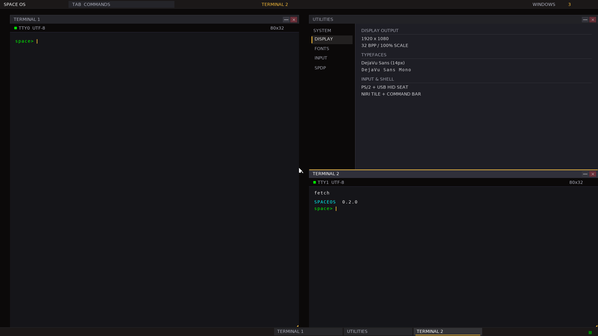
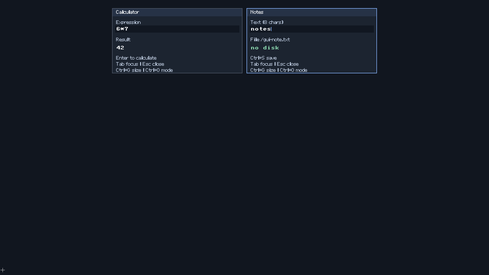

# Actual QEMU captures

These are lossless PNG encodings of captures from the 152/152 passing local
application run at frozen Space source `c408746`. RGB pixels are identical to
the original PPMs. [The capture manifest](captures.json) records dimensions,
source paths and both original/PNG SHA-256 hashes. Screenshots supplement the
input, pixel, persistence and lifetime assertions; they are not standalone proof.

## Native desktop

Two independent native shell sessions, actual `fetch` input/output, measured
DejaVu typography and the updated palette. These are shell sessions, not an
original foreign TUI or PTY implementation.

## Protected native clients

Actual default SCI calculator/editor after keyboard input. The calculator shows
`6*7 = 42`; Notes contains `notes` and correctly reports no disk on this RAM boot.
The editor is still limited to eight ASCII bytes; client typography remains its
own bitmap renderer. These are native clients, not original Windows/macOS apps.

