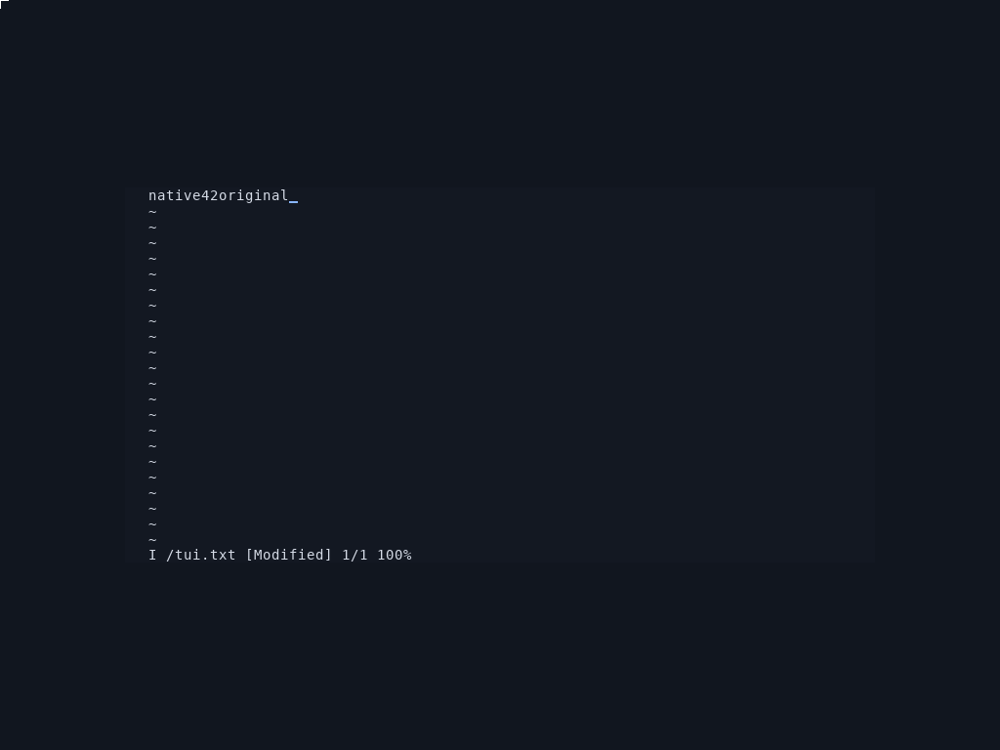
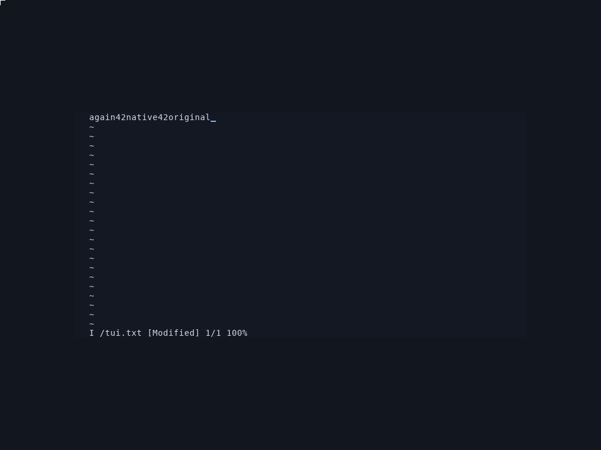
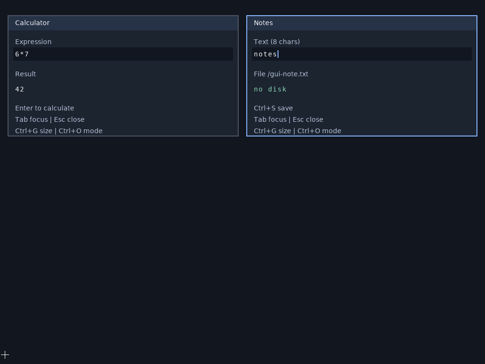

# Original vi running in Space

These are lossless PNG encodings of actual QEMU screenshots at Space source
`32484b0`. The Linux process is the pinned, unmodified BusyBox vi executable;
a separate protected native SCI client owns terminal cells and pixels. These
are not host-rendered substitutes. The [manifest](captures.json) binds original
PPM/PNG hashes, stream prefixes, pixel receipts, compiler and application.

Both captures match all294912 terminal pixels against an independent
pyte/Pillow/pinned-DejaVu oracle. The scenario uses38 actual PS/2 events across
two protected vi processes, including Left/Backspace/Delete interior corrections
and Home/Right/End navigation. It saves exact17-/24-byte files and reopens in a
fresh process. Native/foreign execution contexts and resources are checked.

This is a finite ASCII80x24 integration profile over a quiescent GUI scene.
At this earlier source, reboot persistence was still open; the later cold-boot
scenario below closes that finite gap. Ordinary desktop installation/launch,
tiling, resize and two concurrent foreign terminals remain open. This does not establish Windows/macOS
application compatibility. The [full goal](../../compatibility-coverage-goal.md)
remains active; focused [test receipts](../../plans/2026-10-25-terminal-evidence.json)
retain their exact source scope.

## Cold reboot from the native filesystem

This separate [capture receipt](vi-cold-reopen-capture.json) is from frozen
`82f4210` on the schema2 disk's second independent QEMU boot. Its command has no
ELF staging device: the native file observation supplies the exact installed
original bytes. Actual PS/2 edits and all294912 terminal pixels are checked,
then a third boot verifies both files without changing the disk. Both schemas
pass the [durability scenario](../../plans/2026-10-25-interactive-vi-durability.md).

## Protected native client typography

This is a separate actual QEMU capture at`94799a9`, with lossless pixels and
independent label/content/caret verification. The [capture receipt](protected-font-capture.json)
records its source and hashes. Both SCI clients own their DejaVu coverage and
canvas. The RAM boot correctly shows`no disk`; the separate NVMe tests verify
save/reopen. Notes still holds eight ASCII bytes. The earlier vi captures above
retain their own source revision and do not inherit this later font change.
