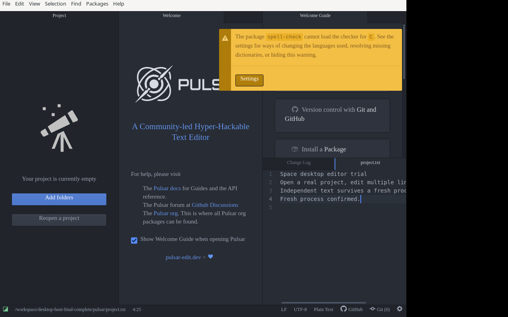
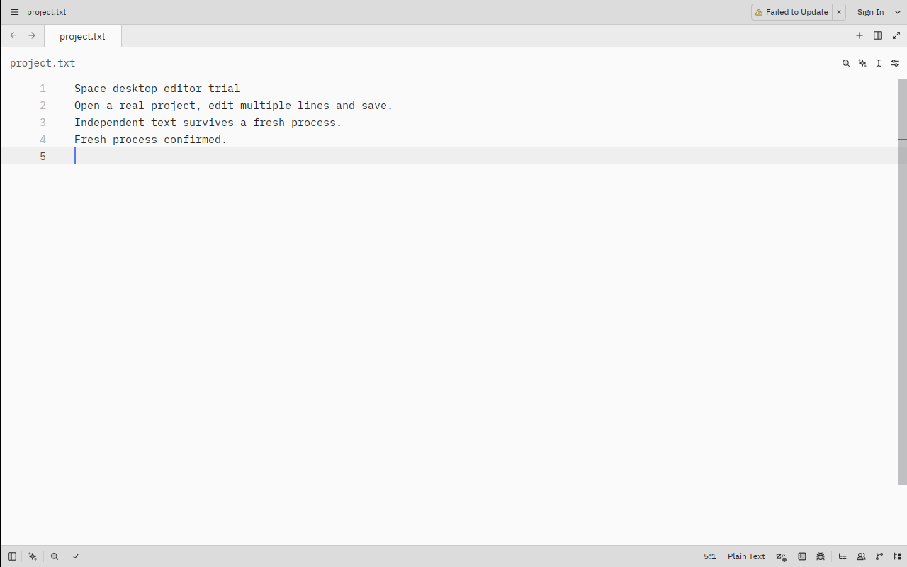
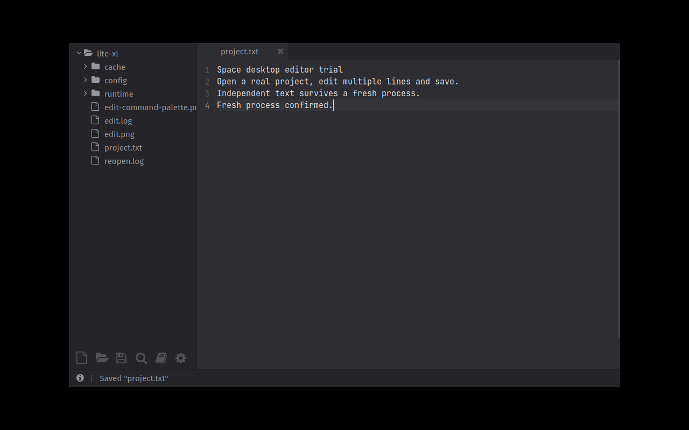
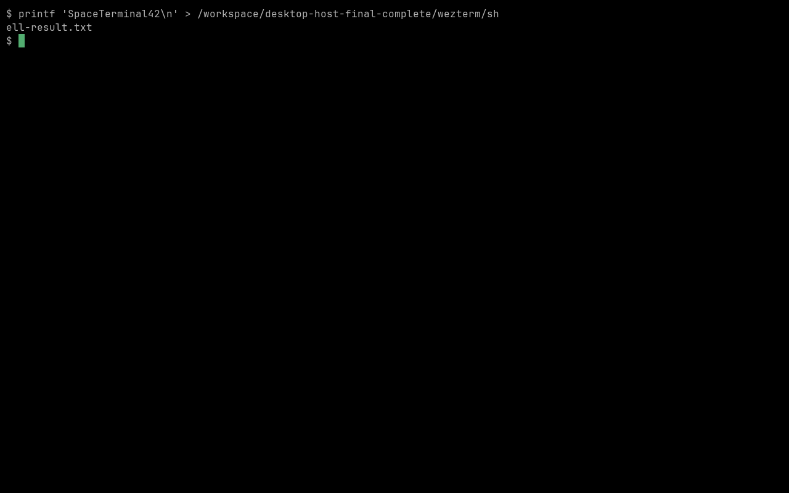
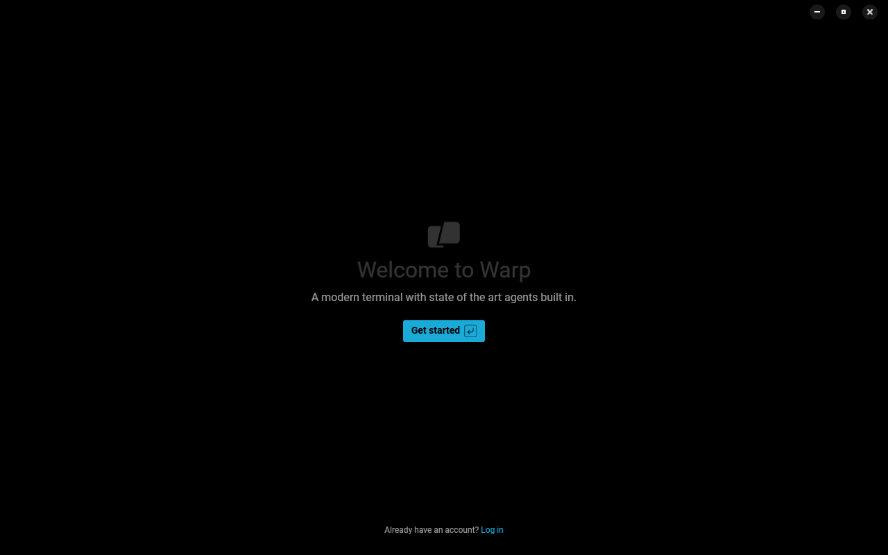
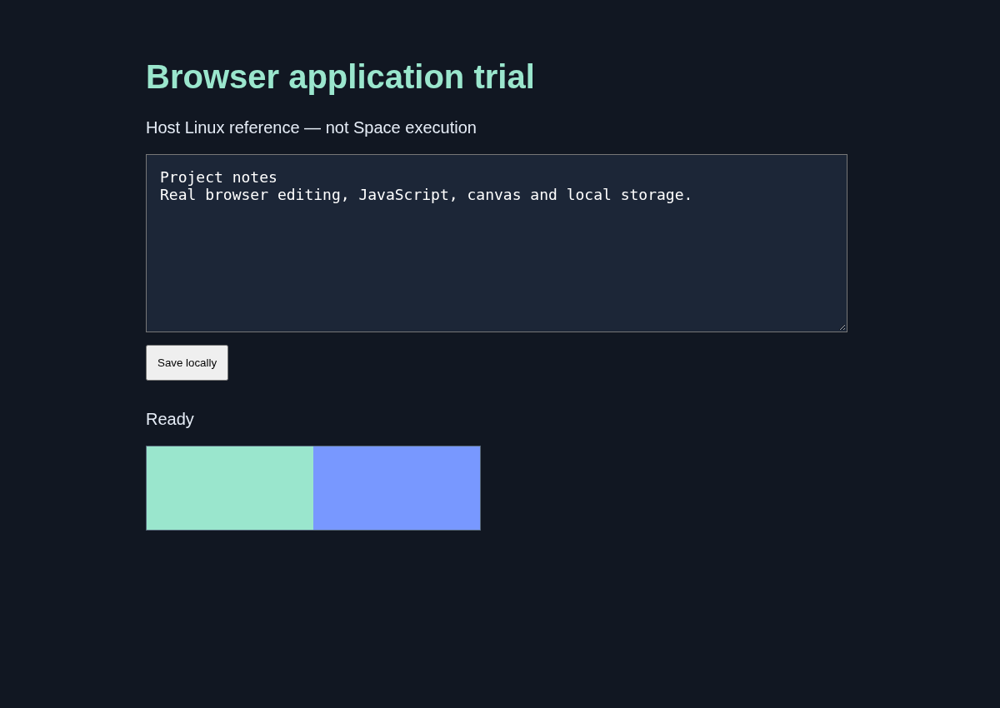
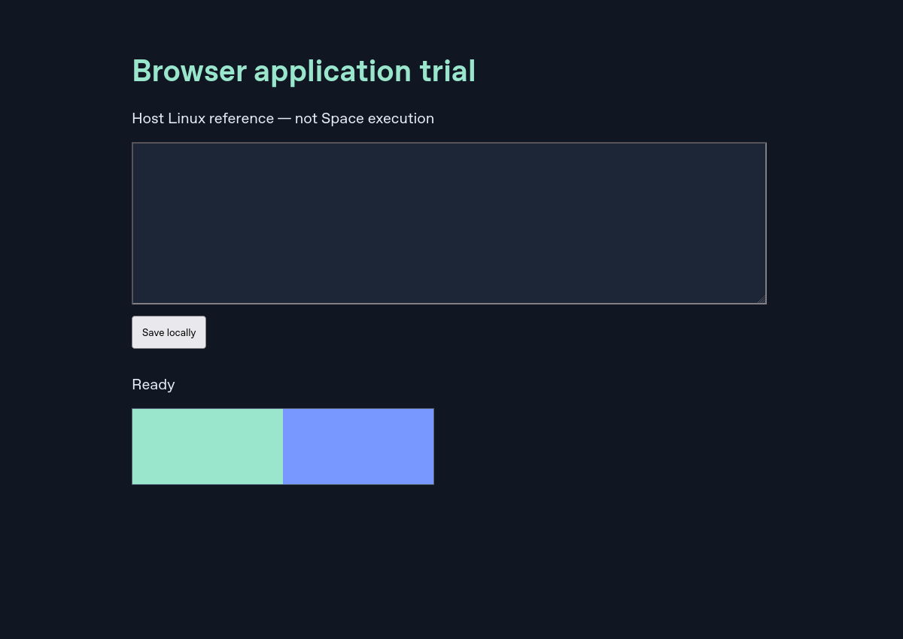

# Host application references — not Space execution

These are actual screenshots of the pinned original apps running on host
Linux. **None of these seven apps has entered Space.** Their separate QEMU
admission results are blocked. The [capture manifest](captures.json) records
source revisions, original paths, byte hashes and exact case scopes. Images
are copied without modification. Local receipts are not hosted artifacts.

The [trial record](../../../plans/2026-10-25-serious-desktop-apps.md) explains the
runtime gaps and distinguishes these references from working Space screenshots.

Pulsar: real editing, exact save, fresh-process reopen, further editing/save and
graceful close.

Zed: the same exact-file workflow on its documented emulated-GPU profile.

Lite XL: exact editing, save/reopen and actual command-palette quit.

WezTerm: software rendering and an actual shell command with exact file output.

Warp: welcome window only; no terminal session or account workflow is claimed.

Helium: real browser text input/button/JavaScript, independently checked canvas
scanout and saved localStorage after a complete browser process restart.

Firefox: actual Gecko page/canvas rendering. This narrower reference does not
claim keyboard interaction or saved-state restart.

